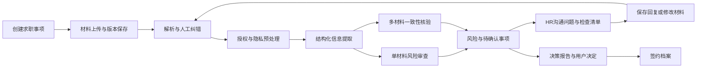
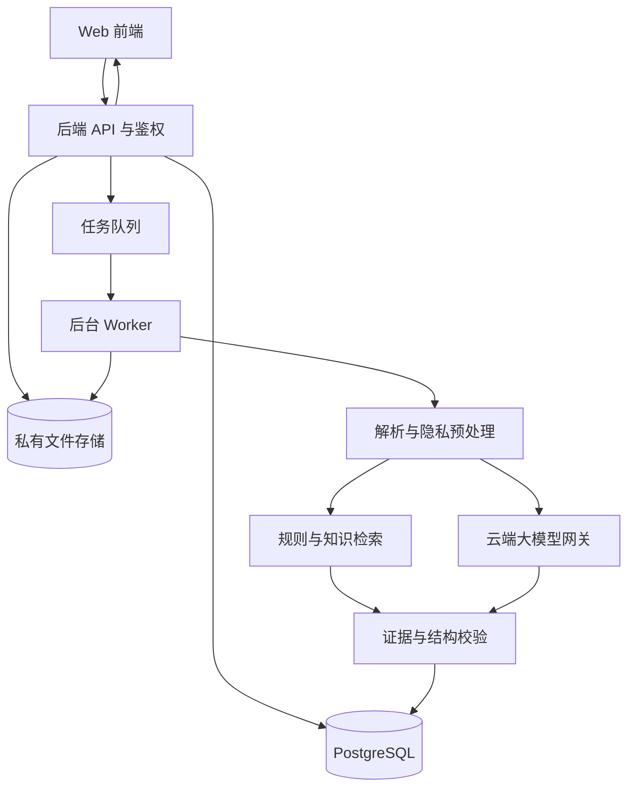
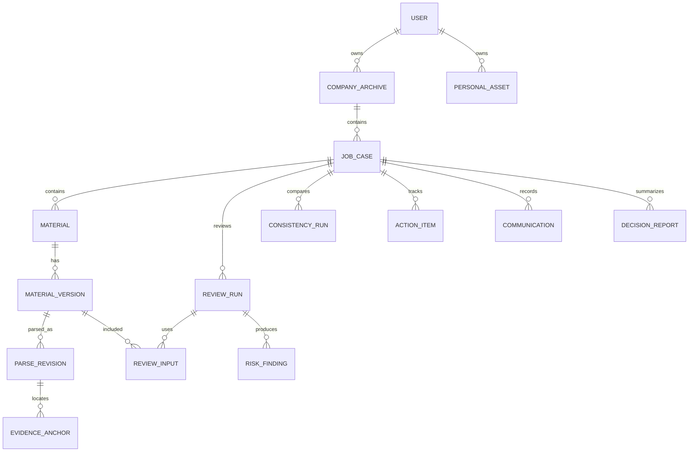

# OfferGuard 项目开发规划

编制日期：2026-11-23  
阶段：产品、架构与开发路线讨论稿  
定位：计算机设计大赛 Web 开发赛道项目  
状态：本文为推荐方案，不代表技术选型、视觉设计或开发范围已经最终确定。

## 1. 产品定位与实施边界

OfferGuard 是面向大学生、应届毕业生及求职者的求职签约管理与决策辅助平台。它将分散的求职材料组织到具体求职事项中，通过信息提取、原文证据审查、跨材料核验和沟通后的再次核验，帮助用户理解签约条件、确认疑点、保存过程并形成决策依据。

产品的中心对象是“求职事项”，而不是聊天会话或单个文件。AI 是业务流程中的处理能力，用户最终获得的是可追溯的风险报告、核验结果、行动事项和签约档案。

建议区分三个概念：

| 概念 | 含义 | 设计理由 |
| --- | --- | --- |
| 企业档案 | 用户保存的某家企业的档案容器 | 同一企业的材料和历史能够集中查看 |
| 求职事项 | 用户针对企业中的某个岗位、某次招聘建立的事项 | 同一企业可以有不同岗位、不同批次，不能混合比较 |
| 材料及其版本 | 招聘信息、Offer、协议、合同、沟通记录等业务材料 | 一份材料可更新多个版本，每次报告必须明确使用哪个版本 |

企业档案初期属于个人用户，不建立未经授权的公共企业风险数据库。不同用户的档案、材料和审查结果不互相可见。企业名称相同也不意味着可以跨用户合并数据。

系统判断的是材料中呈现的签约风险和信息差异，不直接认定欺诈、企业真实性、合同最终效力或用户应当接受哪份 Offer。用户自行作出决定，系统记录其决定和依据。

个人照片、签名是独立个人素材。初期仅提供私有保存、预览、替换和删除，不扩展为电子签章或自动签约能力。

## 2. 现有基础与能力缺口

### 2.1 已查看的项目资料

- `skills/00_统一规范与接口契约.md`
- `skills/接口契约_RiskFinding_RiskReport.schema.json`
- `skills/09_签约主体一致性识别.md`
- `skills/10_薪资待遇风险识别.md`
- `skills/测试集模板.md`
- `knowledge/01_知识库说明与规则正文_OfferGuard.md`
- `knowledge/OfferGuard 就业签约风险审查.json`
- 项目目录中的其余风险 Skill 文件列表。

现有目录包含 12 类风险识别 Skill。知识库说明列出 63 条子规则、25 项法定或审查边界参数，并提供 JSON、Markdown 和 Excel 文件。JSON 声明 Excel 为维护主文件，其他文件为同步快照。

这些资料构成审查规则基础，尚不等于可运行的 AI 服务。本次没有执行审查测试，也没有独立核验全部法规、政策来源的现行有效性。

### 2.2 可以继承的设计

1. 硬规则优先，语义分析处理歧义和上下文。
2. 风险点结构化输出，区分原文事实与风险推断。
3. 证据引用必须来自输入材料，禁止编造依据。
4. 缺少附件、页面或必要事实时标记待核实。
5. 没有命中风险，不等于合同绝对安全。
6. 保留知识依据、规则来源和审查过程的追溯信息。

### 2.3 需要补足的能力

| 现有基础 | 缺口 | 推荐处理 |
| --- | --- | --- |
| 就业协议、劳动合同与附件审查规范 | 招聘信息、Offer、HR记录没有完整抽取规范 | 增加各材料类型的字段与语义规范，合同规则按适用条件调用 |
| 主体一致性 Skill | 不能覆盖薪资、岗位、地点、时间、福利等完整跨材料比较 | 建立独立的一致性核验模块 |
| RiskFinding / RiskReport 字段定义 | 缺少任务、版本快照、证据坐标、行动事项等系统字段 | 保留现有语义，通过适配器扩展并正式化 API Schema |
| 法律名称、条款与来源映射 | 不一定有完整官方原文、有效性核验记录与来源链接 | 发布前补齐并人工审核；缺少时区分规则依据与已核验法律依据 |
| 多格式知识库快照 | 不自动同步，容易出现规则版本漂移 | 建立发布校验、版本记录和变更流程 |
| 测试集模板 | 模板尚未填充真实样本与人工标注 | 建立合法取得、脱敏、人工复核的评估集 |

特别注意：三方就业协议与劳动合同的性质、适用条件不同。不能把劳动合同中的规则机械应用到所有三方协议、Offer 或招聘信息；例如违约责任判断需要先确定文件类型、触发场景和适用关系。

现有 Schema 文件是 RiskFinding / RiskReport 的定义集合，正式接入时需要整理为可被选定校验器直接加载的完整 JSON Schema，明确入口、引用和字段约束；不能仅凭文件扩展名认定契约已经可执行。

## 3. 完整业务流程与状态

### 3.1 主流程

1. 用户登录，在企业档案下创建求职事项，填写岗位、阶段和签约截止时间。
2. 用户上传文件或粘贴文本，指定材料类型、来源和对应事项。
3. 系统校验文件，解析正文、表格和位置；必要时执行 OCR。
4. 用户查看解析结果，补充缺失页、修正明显识别错误。
5. 系统说明 AI 处理范围，用户授权；后端完成隐私预处理。
6. 系统提取主体、岗位、薪资、地点、日期等结构化信息，保留证据来源。
7. 根据文件类型执行风险审查，形成结构化风险报告。
8. 用户选择同一事项中的材料版本，执行多材料一致性核验。
9. 用户查看风险、差异、信息缺口及原文，生成沟通问题和检查清单。
10. 用户自行与 HR 沟通，在系统中保存回复、截图或补充文件。
11. 系统根据新增证据再次核验；修改合同以新版本保存并重新审查。
12. 用户生成当前材料快照对应的决策报告，记录决定并归档。

### 3.2 必须分开的状态

| 对象 | 状态建议 | 约束 |
| --- | --- | --- |
| 求职阶段 | 材料收集中、已获 Offer、签约确认中、已签约、已放弃、已归档 | 由用户操作或明确业务事件改变，不能由 AI 擅自决定 |
| 解析任务 | 等待处理、解析中、待人工补充、完成、失败、取消 | 解析完成不代表审查完成 |
| 审查任务 | 等待处理、隐私处理中、信息提取中、审查中、完成、部分完成、失败、取消 | 不同阶段状态必须来自后端真实执行 |
| 报告适用性 | 当前材料适用、材料已更新需复核、部分来源已删除 | 报告完成状态与是否仍适用于当前材料分开 |
| 风险处理 | 待处理、待 HR 回复、待补充材料、待复核、已解决、用户决定保留 | 用户标记已处理，不自动意味着风险已经消失 |
| 用户待办 | 待完成、进行中、已完成、取消 | 与核验结论分开记录 |

用户上传 HR 回复，不能自动将关联风险标为已解决。需要确认回复是否回答了问题，以及是否还需要将承诺写入正式签约材料。

任务进度优先显示实际阶段和已处理项目；没有可测量的工作量时不显示虚构百分比。

## 4. 推荐技术架构与替代方案

### 4.1 总体建议

推荐采用“模块化单体后端 + 独立后台任务进程 + 关系数据库 + 私有对象存储”。Web 请求处理用户操作，后台任务处理解析、OCR、AI 调用和报告生成。

初期不拆微服务，也不建立多个自主协商 Agent。先让业务流程可控、任务可恢复、结果可追溯，再根据实际复杂度决定是否扩展。

### 4.2 选型讨论表

| 层级 | 推荐方案 | 推荐理由 | 替代方案与适用条件 |
| --- | --- | --- | --- |
| 前端 | React + TypeScript + Vite | 适合交互密集的工作台、文档阅读器和版本比较；类型契约便于协作 | 团队熟悉 Vue 时选 Vue 3 + TypeScript；需要明确 SEO/SSR 能力时考虑 Next.js |
| 前端数据与表单 | React Router、TanStack Query、轻量状态管理与表单校验 | 区分服务端任务状态和本地界面状态，减少重复请求 | Vue 对应生态；小范围页面可先不引入全局状态库 |
| 样式与组件 | 先确定设计规范，再选样式工具及基础组件 | 组件库不能代替产品视觉设计 | Tailwind、CSS Modules 或定制组件均可；根据后续设计方案确认 |
| 后端 | Python FastAPI + Pydantic | 与文件解析、规则处理及 AI 生态衔接直接；可生成 OpenAPI | NestJS 适合团队 TypeScript 更强且愿意维护 Python 解析服务的情况 |
| 数据库 | MySQL 8 + SQLAlchemy + Alembic | 按本机现有 MySQL 环境实施；关系、事务、JSON 与历史版本可满足首批需求 | 不要求安装 PostgreSQL；后续扩展按实际需求评估 |
| 后台任务 | Redis + Celery Worker | 解析和 AI 耗时操作脱离 HTTP 请求，支持重试与任务恢复 | RQ 更简单；具体选择取决于部署经验与任务编排复杂度 |
| 文件存储 | 开发期私有目录并封装存储接口；部署期 S3 兼容存储或云 OSS | 原文件与数据库分离，统一权限和下载路径 | MinIO 适合自托管；单机私有目录可支持小规模部署，但需备份与访问控制 |
| PDF / DOCX 解析 | 评估 PyMuPDF/pdfplumber、python-docx | 可在后端提取文本、表格，建立位置索引 | 根据样本选择；扫描件和复杂版式需要 OCR；确认依赖许可 |
| OCR | 优先后端本地 OCR，例如 PaddleOCR | 避免未脱敏扫描件先进入外部服务 | 云 OCR 需要单独告知、授权和数据流说明 |
| 知识检索 | 按规则、材料类型、主题检索现有 JSON，必要时关键词排序 | 现有知识规模较小，规则命中可以直接映射知识记录 | 内容扩展后加入 pgvector 混合检索；不必初期部署独立向量数据库 |
| AI 接入 | 后端统一模型网关与供应商适配器 | 管理密钥、预算、限流、结构化输出及失败恢复 | 选支持稳定 JSON 输出的 API；具体厂商由实测和成本共同确定 |
| 部署 | Docker Compose + HTTPS 反向代理 | 方便团队复现和比赛部署 | 托管数据库、对象存储和应用服务可降低运维负担 |

以上是讨论建议。前端框架需要结合团队熟悉度确认；不会因为本规划直接创建对应项目。

### 4.3 接口原则

- 前端通过业务 API 获取状态，不直接访问模型、知识库文件或对象存储的管理接口。
- 使用 OpenAPI 描述接口，生成或同步前端类型；风险结果、核验结果和报告均进行服务端校验。
- 上传、审查、核验、导出等操作应支持幂等标识，避免重复点击产生多个昂贵任务。
- 异步操作返回任务 ID；初期通过轮询查询，必要时采用 SSE 更新状态。双向实时通信不是当前必需项。
- 对外响应包含可理解的错误类型和请求 ID；不返回密钥、内部路径或合同全文调试信息。
- 所有事项、版本、报告和下载操作都在服务端检查当前用户所有权。

## 5. 前端页面结构与路由

页面结构先确定业务职责，不规定配色、布局模板、动效或组件造型。主导航可以保留用户提出的六个业务模块，但模块中的材料和任务必须回到明确的求职事项上下文。

| 页面 | 建议路由 | 主要职责 |
| --- | --- | --- |
| 产品介绍 | `/` | 说明能力范围、使用流程与入口，后期按展示需要建设 |
| 登录 / 注册 | `/login`、`/register` | 账号入口与会话管理 |
| 求职工作台 | `/workspace` | 求职事项、截止时间、待办、真实审查状态与风险概览 |
| 求职事项列表 | `/cases` | 搜索、筛选、新建事项 |
| 事项总览 | `/cases/:caseId` | 企业、岗位、阶段、材料完整性、主要风险和下一步行动 |
| 事项材料 | `/cases/:caseId/materials` | 上传、文本录入、分类、版本和解析状态 |
| 材料阅读与解析校正 | `/cases/:caseId/materials/:materialId/versions/:versionId` | 原文预览、位置定位、抽取结果确认 |
| 事项审查历史 | `/cases/:caseId/reviews` | 发起审查、任务状态、报告历史 |
| 风险报告 | `/cases/:caseId/reviews/:reviewId` | 风险解释、证据、建议、待确认项和报告适用性 |
| 一致性核验 | `/cases/:caseId/consistency` | 选择材料版本、对比字段、查看差异及证据 |
| 核验报告详情 | `/cases/:caseId/consistency/:checkId` | 保存某次核验快照并支持回看 |
| 决策助手 | `/cases/:caseId/decision` | 沟通问题、检查清单、待办、决策报告 |
| 沟通记录 | `/cases/:caseId/communications` | 用户问题、HR回复、附件与关联事项 |
| 决策报告详情 | `/cases/:caseId/decision-reports/:reportId` | 当前证据、剩余疑点、行动建议和用户决定 |
| 时间线 | `/cases/:caseId/timeline` | 材料、审查、回复、版本修改及归档事件 |
| AI 材料审查中心 | `/review-center` | 汇总任务与报告；发起前选择或创建求职事项 |
| 全局决策助手 | `/decision-assistant` | 汇总待办与待确认项，跳转到对应事项 |
| 企业档案列表 / 详情 | `/archives`、`/archives/:companyId` | 企业下的事项、材料、报告、版本与历史检索 |
| 个人资料 | `/settings/profile` | 用户资料 |
| 个人素材 | `/settings/assets` | 独立照片、签名保存与删除 |
| 隐私设置 | `/settings/privacy` | AI处理授权、数据使用说明与授权记录 |
| 数据管理 | `/settings/data` | 数据导出、材料删除、事项删除与账号数据处理 |

这些是信息架构，不要求首期实现所有独立页面。时间线、沟通记录等可以先做为事项内的页签，降低导航复杂度。

核心交互要求：

- 风险卡片能够打开对应版本的原文并定位；不把内部 Skill 编号、规则技术字段作为主要业务文案。
- 比较页面保留各材料自己的值、条件和证据，不能只显示一条模型摘要。
- 空状态、处理中、失败、部分完成、待补充和材料已更新有明确界面。
- 面向用户默认展示业务解释与核心依据；来源详情按需展开。本文不沿用旧项目的视觉设计，等待用户提供 OfferGuard 的设计想法。
- 用户操作前后状态真实一致；没有上传或审查时，不显示已有报告或“已完成”。

## 6. 后端功能模块与接口职责

| 模块 | 核心职责 | 典型 API 能力 |
| --- | --- | --- |
| 账号与权限 | 注册、登录、会话、所有权校验、限流 | 登录退出、当前用户、会话失效 |
| 企业与求职事项 | 企业档案、岗位、阶段、截止时间、归档 | 事项创建查询更新、企业档案检索 |
| 材料与版本 | 文件、文本、来源、版本关系、附件清单 | 上传、创建新版本、选择当前版本、私有预览 |
| 文档解析 | 文本层解析、OCR、表格、证据位置、人工修订 | 解析任务、结果查询、修订确认 |
| 隐私处理 | 敏感识别、脱敏、处理策略与授权快照 | 处理范围查询、授权、脱敏状态 |
| 事实抽取 | 标准字段、原始表述、单位、条件、缺失与置信信息 | 抽取结果查询、人工纠正 |
| AI 网关 | 密钥管理、模型适配、Schema 校验、预算、失败恢复 | 内部调用，不提供任意公开提示词执行接口 |
| 风险审查 | Skill 路由、硬规则、语义分析、去重与证据校验 | 创建审查、查询任务、查询报告 |
| 一致性核验 | 版本选择、字段对齐、条件比较、差异分类 | 创建核验、结果查询 |
| 行动与沟通 | 风险关联、HR问题、待办、回复、复核 | 问题生成、回复保存、状态更新 |
| 决策报告 | 汇总当前证据、未决事项、用户偏好与决定 | 生成报告、查询、导出 |
| 搜索与档案 | 企业与事项检索、分类筛选、时间线 | 档案搜索、历史查询 |
| 个人素材 | 照片、签名专用存储与权限 | 私有上传预览删除，禁止进入审查队列 |
| 数据治理 | 删除编排、派生数据清理、导出、保留策略 | 删除任务、状态查询、个人数据导出 |
| 任务与运行记录 | 队列、阶段、重试、取消、内部运行追踪 | 任务状态、失败原因、取消与重试 |
| 知识与规则发布 | 数据校验、来源审核、版本发布 | 初期可用受控维护流程，不必先开发后台管理网站 |

建议 API 资源围绕 `cases`、`materials`、`versions`、`reviews`、`consistency-checks`、`action-items`、`communications`、`decision-reports` 和 `jobs` 组织。接口命名是草案，开发前形成契约。

## 7. 数据库核心实体与关系

### 7.1 实体设计

| 实体 | 关键字段或内容 | 关系与约束 |
| --- | --- | --- |
| User | 账号、资料、状态、创建时间 | 数据所有者 |
| CompanyArchive | 用户、企业显示名、备注 | 用户下企业档案；不自动认定工商主体 |
| JobCase | 企业档案、岗位、阶段、截止时间、归档时间 | 一个企业档案可以有多个求职事项 |
| Material | 事项、类型、标题、来源、当前版本引用 | 一份业务材料对应多个版本 |
| MaterialVersion | 材料、版本序号、文件或文本引用、内容哈希、时间 | 原始内容不覆盖；人工修订产生新解析修订记录 |
| StoredFile | 私有对象键、MIME、大小、哈希、所有者、用途 | 禁止任意路径；个人素材具有独立用途限制 |
| ParseRevision | 材料版本、解析器版本、正文、布局引用、用户修订 | 重新解析和人工纠错可追溯 |
| EvidenceAnchor | 解析修订、页/段/消息位置、文本区间、坐标、片段哈希 | 引用指向确定版本及解析修订 |
| ExtractionRun / ExtractedFact | 输入快照、字段、原始值、标准值、单位、条件、来源 | 同一字段允许多个事实，不覆盖矛盾信息 |
| ReviewRun | 事项、输入版本集合、抽取快照、规则/知识/提示词/模型版本 | 一次运行生成不可变报告快照 |
| RiskFinding | 所属运行、类型、严重程度、确认状态、解释、建议 | 与证据及知识记录关联 |
| ConsistencyRun / ConsistencyItem | 材料集合、比较字段、各来源值、状态、说明 | 独立于单材料审查 |
| FindingResolution | 风险项、处理状态、回复证据、复核记录 | 管理后续处理，不改写历史判断 |
| ActionItem | 事项、关联风险/差异、内容、状态、截止时间 | 可关联多个发现；用户完成与AI复核分开 |
| Communication / CommunicationLink | 问题、回复、时间、渠道、附件、关联行动 | 一次回复可以回答多个问题 |
| DecisionReport | 使用的运行快照、剩余问题、建议、生成时间 | 新证据到来后标记需更新，保留原报告 |
| DecisionRecord | 用户决定、原因、决定时间、参考报告 | 与 AI 建议分开保存 |
| ConsentRecord | 用户、材料范围、处理目的、策略版本、供应商范围、时间 | 每次外部处理可追溯授权 |
| PersonalAsset | 用户、类型、文件引用 | 不关联审查输入 |
| Job / ModelCallRecord | 状态、阶段、幂等键、尝试次数、耗时、费用统计、错误类型 | 不保存完整合同或完整模型请求日志 |
| KnowledgeRelease / RuleRelease | 版本、来源校验状态、发布日期 | 运行绑定具体发布版本 |
| TimelineEvent / DeletionJob | 业务事件、删除范围、执行状态 | 时间线与数据删除闭环 |

阶段一无需把所有实体拆成单独的表。结构化结论、事实细节可适度使用 JSONB；所有权、版本引用、任务和行动关系保留明确关系字段。

### 7.2 主要关系

### 7.3 数据完整性原则

- 所有资源引用必须验证同一用户、同一事项范围；跨事项引用不得仅凭 ID 成功。
- 材料版本序号在同一材料内唯一；内容更新、重新解析和知识发布分别记录版本。
- 报告绑定输入版本、解析修订、抽取快照和规则知识版本，禁止静默改写历史报告。
- 当前版本更新后，关联报告标记需复核；用户可以查看原报告，但不能误认为适用于新合同。
- 派生结论和原始事实分开；人工纠正保留来源，不能伪装成材料原文。
- 对删除来源的报告，在清理敏感派生内容后仅保留必要的非敏感状态记录，不保留可还原原文的证据副本。

## 8. AI 调用流程与结构化输出

### 8.1 调用流程

1. **确定输入快照**：用户选定事项、材料版本和审查范围，后端验证所有权、授权和预算。
2. **解析质量检查**：判断文本层、OCR、页数和附件是否可用；不可读材料先返回待补充。
3. **隐私预处理**：敏感识别、占位替换、按审查需求筛选片段；保留后端私有位置映射。
4. **事实抽取**：对不同材料使用对应 Schema，提取字段、条件和证据引用；缺失值为 null。
5. **规范化与确认**：规范金额、日期和期限，保留原始值；明显歧义允许用户确认。
6. **规则路由**：按文件类型、条款主题与事实条件选择适用 Skill，避免全量无差别调用。
7. **确定性检查**：金额比例、期限档位、空白项等先用程序校验；未知事实不套用默认值。
8. **知识检索**：检索真实记录，筛选地区、文件关系、时间及有效性；没有合适依据时保留待核实。
9. **语义审查**：模型接收必要条款、上下文与检索结果，输出风险结构；文档内指令只作为材料内容。
10. **一致性核验**：先按标准字段确定性比较，再处理条件歧义、简称或语义差异。
11. **结果校验**：校验 JSON、字段类型、证据归属、原文匹配、知识引用存在性和版本范围。
12. **落库与行动生成**：保存可追溯报告；按用户请求生成沟通问题、清单和决策报告。

一个模型调用失败不应使已经完成的解析或其他材料审查丢失。任务保存阶段成果，允许有限重试；部分失败显示部分完成和未覆盖范围。

### 8.2 核心输出契约

| 输出 | 必须保留的信息 |
| --- | --- |
| ExtractedFact | 字段名、原始表述、标准值、单位、适用条件、证据引用、提取状态 |
| RiskFinding | 风险类型、严重程度、确认状态、原文证据、解释、建议、缺失信息、真实知识引用 |
| ConsistencyItem | 比较维度、材料版本、各来源值与条件、核验状态、差异说明、待确认问题 |
| ActionItemSuggestion | 行动内容、关联发现、所需证据、建议顺序、完成判据 |
| HRQuestion | 问题正文、关联风险或差异、期望确认内容；用户编辑并自行沟通 |
| DecisionReport | 审查范围、已确认条件、未决问题、证据覆盖不足、行动建议、生成时间 |

风险严重程度、结论确认状态和后续处理状态是不同概念。现有契约中的“待核实”同时出现在风险等级与命中状态中，可以先通过兼容适配继承，后续讨论将严重程度与确定性拆开，避免业务歧义。

模型输出的 confidence 只是模型自述，不等于经过校准的概率。前端不宜用“95%准确”之类表述；应优先显示证据充分性和核验状态。

### 8.3 一致性核验规则

| 状态 | 使用条件 | 示例 |
| --- | --- | --- |
| 信息一致 | 值、单位和适用条件可比且相符 | Offer 与合同都明确同一岗位税前固定月薪 8,000 元 |
| 存在差异 | 相同维度、相同条件下的明确值不同 | 两份材料对同一岗位的固定工作城市约定不同 |
| 信息缺失 | 应比较的某份材料没有对应字段，且解析范围足够明确 | Offer 有入职日期，完整合同材料未提供相应约定 |
| 无法核验 | 口径、条件、来源完整性或解析质量不足，不能可靠比较 | “最高月薪 12,000 元”与“固定工资 8,000 元+绩效” |

某维度可以同时出现“可比材料存在差异”和“另一材料信息缺失”，应保留来源级结果；不能用单一汇总状态覆盖事实。若部分材料解析失败，应标记无法核验而不是声称未写相关信息。

薪资必须保留固定/浮动、税前/税后、周期、币种、试用/转正和保证/条件性支付等信息。年薪、月薪、奖金不能无条件折算；“13 薪”需要确认发放条件。

主体名称区分品牌、简称、法人、派遣单位与用工单位。日期区分预计日期和实际事件。HR记录保留发送人角色、时间和用户提供的来源，不认定截图或文本天然真实。

HR解释与正式合同的关系不能由系统任意决定。回复可以澄清事实，但正式合同仍保留不同约定时，应继续提示需要书面更新或确认。

### 8.4 证据定位

PDF 保存页码、文本区间和必要坐标；DOCX 保存段落、表格和单元格位置；纯文本保存字符区间；聊天材料保存消息及时间位置。

模型优先返回后端分配的证据 ID，不依赖模型生成页码或坐标。后端检查证据引用是否属于当前输入并支持解释；逐字匹配只能验证引用存在，不能单独证明结论正确。

脱敏造成文本长度改变时，不能直接使用脱敏文本偏移定位原文件。需要片段 ID 和后端映射。OCR 引用来自识别文本时，应能回看原始图像；识别不清楚的金额、日期和空白栏要求确认。

## 9. 隐私保护与数据生命周期

隐私处理是核心流程的一部分，不能推迟到所有 AI 功能完成后再补。

| 环节 | 推荐机制 | 必须说明的限制 |
| --- | --- | --- |
| 材料进入系统 | 文件类型、大小、解析安全检查；私有存储 | 用户原始材料仍在服务端私有保存 |
| 解析与 OCR | 后端本地处理优先；限制解析资源与执行时间 | 云 OCR 会接触原始图像，不能以文本脱敏机制掩盖 |
| 敏感识别 | 规则识别手机号、证件号、银行卡、邮箱等；补充姓名与地址识别 | 自动识别可能漏检，脱敏不等于完全匿名 |
| 脱敏与最小传输 | 使用稳定占位符、按任务筛选必要片段 | 薪资和岗位等必要信息仍可能具有敏感性或再识别风险 |
| 用户授权 | 明确材料范围、目的、外部服务与策略版本；授权可追溯 | 撤回授权阻止后续调用，不能宣称已发往供应商的数据可即时追回 |
| 模型接口 | 密钥仅在后端，供应商配置和超时限流统一管理 | 选型时核查供应商留存、训练使用及删除政策 |
| 文件访问 | 用户所有权校验，私有桶，短时访问链接或后端代理 | URL 中的资源 ID 不是权限凭证 |
| 日志 | 默认仅记录任务 ID、阶段、耗时、Token、错误类型 | 不记录合同全文、证件号、完整请求或响应；错误信息也需过滤 |
| 个人照片与签名 | 独立用途字段、存储分区和服务端审查输入白名单 | 不能只在前端隐藏入口来隔离 AI 处理 |
| 数据删除 | 原文件、解析文本、脱敏映射、抽取事实、证据、缓存、导出文件等统一清理 | 仅设置 deleted_at 或软删除不代表敏感数据已清除 |
| 备份与导出 | 导出文件同样私有；制定备份到期清理和恢复后删除补偿机制 | 告知备份保留期限，不能承诺无法实现的即时备份擦除 |

建议提供处理前的脱敏预览或摘要，让用户确认明显漏检，但不要依赖用户逐项确认来代替后端保护。

涉及同一主体跨材料关联时，在事项内保持一致占位符；企业名称等确为核验所需的信息可以按目的保留。真实敏感字段和占位映射只在受控后端访问。

删除任务先撤销访问并阻止排队任务继续读取，再清理各类副本；处理正在运行的任务与删除竞态，防止数据清理后被旧 Worker 再次写回。

## 10. 模块依赖与开发顺序

### 10.1 依赖关系

| 功能 | 主要前置依赖 |
| --- | --- |
| 企业档案与求职事项 | 账号、所有权与数据库 |
| 材料管理 | 事项、私有文件存储、版本机制 |
| 原文定位 | 版本、解析修订、证据位置模型 |
| AI 抽取 | 解析质量、授权、隐私处理、模型网关 |
| 单材料审查 | 抽取、Skill 路由、知识发布、结果校验 |
| 多材料核验 | 事项级材料集合、字段规范化、来源和版本快照 |
| 沟通闭环 | 风险与差异实体、行动状态、沟通来源 |
| 二次审查 | 新版本、历史快照、问题关联和复核机制 |
| 决策报告 | 当前风险、核验结果、未决事项、用户偏好与快照 |
| 档案搜索与时间线 | 各模块的可追溯实体和业务事件 |
| 数据删除 | 资源依赖登记、任务控制、各存储清理能力 |

账号、权限、版本、任务状态和删除能力贯穿全部阶段，不作为最后的附加项。

### 10.2 分阶段路线与验收

在团队规模、投入时间和比赛截止日期尚未明确时，以验收里程碑安排顺序，不承诺固定总工期。确定这些信息后再换算成周计划。

| 阶段 | 目标与范围 | 可运行验收 | 下一阶段条件 |
| --- | --- | --- | --- |
| 0：方案确认 | 确定首期范围、框架、实体、接口草案；逐页讨论用户设计想法 | 页面职责、核心状态和接口关系能够解释完整流程 | 核心设计与选型已确认 |
| 1：业务与文件基础 | 账号、企业档案、事项、私有上传、版本、删除、基础工作台 | 真实用户可创建事项、保存材料、退出重登恢复；另一账号无法访问 | 资源所有权和版本可靠 |
| 2：解析与隐私基础 | PDF 文本层、DOCX、文本；解析质量、位置索引、脱敏和授权；OCR按阶段加入 | 真实文件可预览定位；个人素材无法进入审查；隐私传输范围可验证 | 输入和证据可追溯 |
| 3：首条审查链路 | 接入统一模型网关，优先薪资、试用期、社保等关键规则 | 一份真实脱敏合同生成结构化报告，风险能定位原文；失败可重试 | 证据和结构校验有效 |
| 4：多材料核验 | 招聘信息、Offer、合同、HR记录抽取；薪资、岗位、地点、入职时间优先 | 两份或更多材料可展示一致、差异、缺失、无法核验 | 比较口径和来源清楚 |
| 5：决策闭环 | 沟通问题、待办、HR回复、新版本、复核、签约清单和决策报告 | 发现问题→保存回复→新合同→再次审查→报告→归档全程可运行 | 一个真实完整场景贯通 |
| 6：覆盖与完善 | 三方协议、其他 Skill、OCR优化、全文搜索、报告导出、个人中心完善 | 需求覆盖有明确清单，未支持功能准确标示 | 主流程和关键边界通过 |
| 7：评估与展示 | 人工标注评估、权限与删除验证、部署、演示材料、比赛文档 | 线上可访问、实测指标可复核、故障时仍可查看历史报告 | 可提交与展示 |

优先级建议：

- **首期必须完成**：事项管理、版本保存、原文定位、真实结构化审查、基础一致性核验、沟通复核、决策报告、用户隔离、隐私授权与删除。
- **闭环稳定后扩展**：全部风险维度、复杂扫描件、档案深度检索、精细版本差异、报告格式美化。
- **有时间和稳定数据源再考虑**：招聘平台自动抓取、工商实时查询、复杂政策自动更新、浏览器扩展。

个人照片与签名管理可以与核心链路并行实现简单版本，但隔离机制要从文件模型设计时就存在。

团队可围绕契约并行：前端负责逐页设计与交互，后端负责资源和数据生命周期，AI负责解析、抽取、规则与评估。使用明确标注的开发夹具可以联调接口，但不能把夹具当成真实 AI 结果或比赛实测数据。

## 11. 主要技术风险与验证重点

| 风险 | 对产品的影响 | 应对与验证 |
| --- | --- | --- |
| PDF表格、扫描件和聊天截图解析错误 | 工资、日期和主体抽错，后续比较失真 | 保留版式证据；用代表性样本评估；低质量要求补充或校正 |
| 规则适用关系错误 | 三方协议、实习协议、劳动合同被混为一谈 | 类型与适用条件先行；建立例外和反例测试；法律依据人工核验 |
| 模型幻觉与断章取义 | 编造风险、条文或原文 | Schema、证据归属、来源有效性和上下文校验；证据不足待核实 |
| 薪资口径和条件丢失 | 将不同薪酬结构误判为矛盾 | 原始值与标准值双保存；税、周期、固定浮动、条件分别建模 |
| 版本漂移与旧结论误用 | 新合同使用旧报告 | 输入快照、材料更新事件、报告适用性提示 |
| 新回复被过度采信 | HR解释后错误关闭风险 | 区分沟通证据与正式约定，闭环状态需要实际复核 |
| AI 超时、限流、价格波动 | 用户等待、任务重复、成本失控 | 队列、预算、限次重试、幂等、阶段成果保存；实测后定模型 |
| 文档提示词注入 | 材料中的文字操纵模型 | 文档视为数据，限制工具权限；服务器校验，加入恶意指令反例 |
| 文件与资源越权 | 私有合同或签名泄露 | 每个资源执行所有权检查；验证读取、下载、导出和删除的越权路径 |
| 脱敏漏检与派生数据残留 | 隐私保护承诺与实际不一致 | 多类敏感样本测试、传输范围检查、全链删除验证 |
| 知识快照不同步或过时 | 判断依据不一致 | 明确唯一维护来源、发布审核、版本绑定、历史可回溯 |
| 缺少稳定外部数据 | 自动查询功能无法可靠运行 | 手工录入、文件上传优先；未接入时明确标示，不伪造查询结果 |
| 演示环境网络不稳定 | 无法及时完成实时 AI 审查 | 提前实测、保留真实历史报告和录屏；实时失败如实显示 |
| 范围过大与设计返工 | 核心链路无法交付 | 每阶段验收；先贯通少量材料和关键维度，再扩展覆盖 |
| 依赖许可及部署资源不足 | 提交、发布或性能受影响 | 确认解析/OCR库许可和资源预算，固定环境并测量真实延迟 |

无需为每个页面文案编写测试。验证重点应放在跨材料语义、规则例外、原文证据、版本快照、权限隔离、删除和可恢复任务这些容易破坏业务可信度的部分。

## 12. 面向计算机设计大赛的实现与展示建议

### 12.1 可证明的四项创新

| 创新方向 | 产品展示 | 需要的实现证据 |
| --- | --- | --- |
| 多源材料关联与核验 | 同一事项内对比招聘、Offer、HR记录与合同 | 标准字段、条件模型、来源引用、不同核验状态 |
| 基于原文的风险审查 | 风险卡片打开对应版本条款 | 稳定证据索引、引用校验、实际样本 |
| 沟通到复核的决策闭环 | 问题、回复、新版本、变化与剩余待办 | 行动关联、历史快照、二次审查和决策报告 |
| 隐私保护型审查 | 脱敏前后、实际外传范围、素材隔离与删除 | 后端处理机制、权限测试、派生数据清理及数据流说明 |

每项创新应对应界面行为、后端机制和验证结果。不要仅靠“多智能体”“知识库”等术语包装。

### 12.2 建议演示主线

选择一组合法取得并脱敏的求职材料，围绕一个求职事项演示：

1. 创建企业与岗位事项，录入招聘信息并上传 Offer、合同。
2. 展示解析与隐私处理范围，完成结构化审查。
3. 查看薪资或地点差异，同时展示一个因条件不足而“无法核验”的项目。
4. 点击风险定位原文，生成具体 HR 沟通问题。
5. 保存预先准备、来源明确的 HR 回复或修改材料。
6. 上传新版本并复核，展示已变化的条款与仍需确认的问题。
7. 生成决策报告，记录用户决定并查看档案时间线。

比赛展示可以使用明确说明的自编案例或合法脱敏材料。自编案例只能证明系统行为，不能冒充真实用户数据、企业事实或识别准确率。预先计算的报告须说明为历史真实运行结果，不能伪装成现场即时生成。

演示优先体现完整闭环和谨慎判断。失败状态、缺失信息和需要用户确认的地方能够真实呈现，也是系统完整性的证据。

### 12.3 评估设计

建议覆盖真实脱敏合同、自编边界案例、信息一致案例、差异案例、缺失附件、低质量扫描件和规则例外。由有相关知识的人员复核标注，记录争议样本和裁决过程；训练/调试样本与最终评估样本分开。

| 评估维度 | 指标与说明 |
| --- | --- |
| 信息提取 | 字段准确率或 F1，分别报告薪资、主体、地点、日期等字段；数值与条件分别评估 |
| 风险识别 | Precision、Recall、F1，按风险类型报告；记录待核实的占比和评价口径 |
| 证据质量 | 引用存在率、定位成功率、人工判断的证据支持率；三者不能混为同一指标 |
| 一致性核验 | 四类状态混淆矩阵、误报率、条件不明确时的合理保留判断 |
| 闭环表现 | 标准任务完成率、沟通后的问题处理正确性、剩余风险识别情况 |
| 隐私保护 | 各敏感类别召回与误脱敏率、实际外传字段、个人素材进入审查被拒绝的验证 |
| 工程运行 | 任务成功率、典型与 P95 耗时、重试恢复情况、单次审查费用 |
| 数据治理 | 跨用户访问拒绝、删除后不可访问、派生内容清理和备份期限说明 |

可设置对比实验：直接大模型审查、规则与模型结合、加入知识检索和证据校验；隐私预处理前后比较敏感传输与业务字段抽取表现。相同样本、模型和评价标准下比较，避免把多个变量同时变化造成的结果归因于某一创新。

### 12.4 展示与提交材料

建议准备产品说明、核心流程图、架构图、数据模型、AI 数据流、隐私机制说明、接口文档、部署说明、测试与评估报告、系统截图、完整演示录屏、团队分工和依赖许可说明。

视觉设计应体现求职材料管理和签约决策场景，围绕文档、事实、证据、差异、待办和时间线组织，不以聊天框作为产品中心。具体视觉方案由用户逐步提供后共同确定。

本规划未查阅特定届次、赛区的官方通知，不能保证评分或奖项。项目范围、提交格式、部署与视频要求应以实际参赛通知为准，再建立逐项对应的验收清单。

## 13. 下一步讨论与协作约定

推荐按以下顺序收敛：

1. 明确比赛截止时间、团队人数、成员技术熟悉度和实际部署条件。
2. 确认首期闭环范围与支持的文件类型，保留后续扩展清单。
3. 确认前后端、数据库和任务技术方案。
4. 由用户提供求职工作台及事项页面的设计想法，逐页确定信息布局与交互状态。
5. 确认核心实体和首批接口契约，再开始业务基础模块开发。
6. 按“设计确认→模块实现→真实运行验收→继续下一模块”推进。

最初规划阶段仅形成本文档。以下记录后续实施进度。

## 15. 当前实施进度（2026-11-23）

官网及应用内页面已实现；本设备工作区保留。首批后端采用 FastAPI + MySQL，提供账号、会话、账号所有权校验、事项、私有上传、材料历史版本、正文解析、待办、HR 记录、个人资料与独立素材管理及删除队列。前端登录入口与业务 API 已接入。

本设备数据与账号数据分别保存，不自动上传原本地材料。账号版本的原件按需鉴权下载。后端启动、数据库配置与迁移步骤见 `backend/README.md`。本机 MySQL 已创建项目专用账号，完成首批迁移，健康检查与真实浏览器账号业务联调通过；测试账号及测试原件已清理。

已接入 DeepSeek 单材料风险线索审查，加载同学维护的完整 12 类 Skill、63 条规则及 25 条接受边界。按材料原文关键词路由主题，完整性和主体核对始终参与；未进入主题明确标示。账号模式在具体版本页面预览脱敏文字与完整输入并授权，任务与报告持久化到 MySQL，可定位原文、查看规则依据并保存待确认问题。密钥只存后端；个人照片、签名和资料不进入模型输入。设置字符/token 上限、调用配额、版本快照幂等、失败手动重试和级联删除；不可靠的规则编号与原文引文会被拒绝。已用合成合同完成完整 Skill 的真实模型验证，生成 8 项待核实线索，未向模型发送用户实际材料。

官网、登录和内部工作区已用入口守卫衔接；事项内提供“材料→审查→核对→沟通→决定→归档”导航，上传后直接进入对应版本。审查支持可拖动分栏、独立报告阅读、全量 TXT / HTML 导出与打印 PDF。真实 AI 追问接口只使用当前报告，先预览并单独授权，验证引用归属，历史随报告删除，与审查共享每日 10 次调用上限；该接口已通过 mock 验证，尚未付费实测追问。

多材料页面现在展示实际版本原文和六个核对主题，用户可保存状态、理由与引用版本；HR 沟通、待确认、修改版本、决定快照和档案彼此关联。决定为用户记录，档案支持目录与记录导出。官网、登录及工作台加入活泼标题字体、直接绘制的 Q 版守护小猫和轻动效，并支持减少动态效果偏好。前端生产构建与 6 项浏览器测试通过。

目前没有接入 OCR、自动跨材料语义一致性判断、自动综合签约建议或电子签署。知识库法律效力尚未独立核验，所有输出均需人工确认，不将未命中等同安全。原有 Skill 与知识库原件未改动，后端直接读取；维护方法见 `backend/README.md` 与应用知识库页面。
